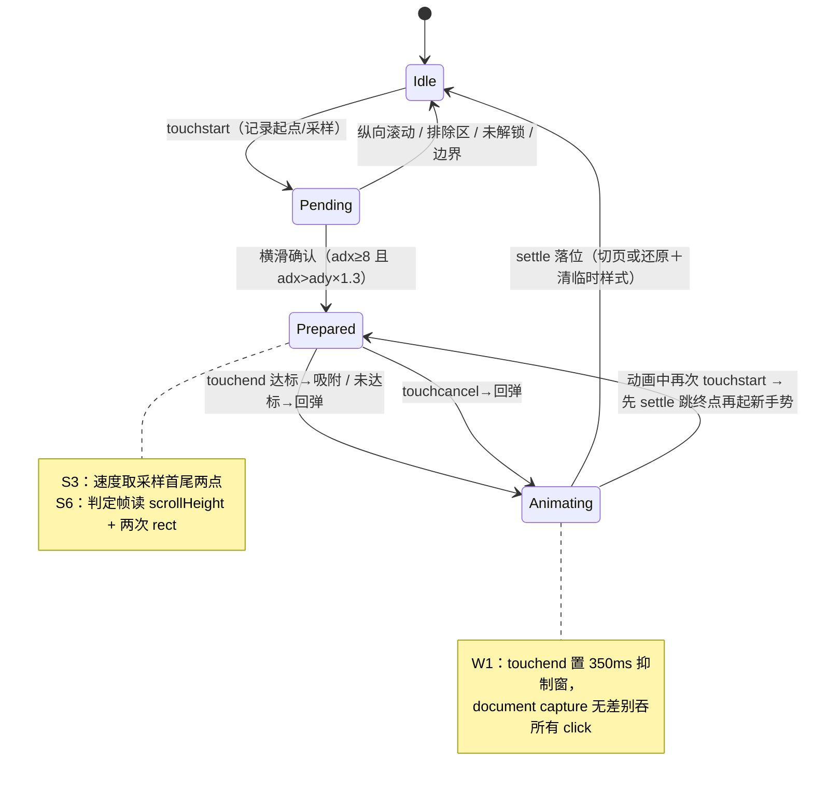

# 左右切换页面功能 · 穷举走查报告

> 走查人：Luna（体验评审与设计系统专家）｜日期：2026-11-22
> 对象：板块内左右滑切换子页（材料库「材料图库 ↔ 安装图库」；课程体系「课程分类库 ↔ 练习题全库」）

## 一、范围与方法

| 项 | 内容 |
|---|---|
| 核心代码 | `static/app.5b87c57683.js` 3446–3750 行（手势状态机）、548–556（`IG_mode`）、1786–1797（`CG_mode`）、3414–3444（全局手势锁） |
| 样式/结构 | `index.html` 95–138（切换器、touch-action、桌面吸顶）；`app.a73abab08c.css` 1759/3339（reduced-motion） |
| 方法 | 逐行静态走查 + Playwright/CDP 触摸实测 4 项 |
| 分级 | **Blocker** 不可用 ／ **Warning** 影响体验 ／ **Suggestion** 可优化 |
| 评估锚点 | 用户能否更快、更准、更安心地切换；是否守住可访问性基线 |

## 二、结论概览

功能整体可用，**无 Blocker**。发现 **3 个 Warning、9 个 Suggestion**，其中 1 项已实测复现（W1）。

| # | 级别 | 维度 | 问题一句话 | 位置 |
|---|---|---|---|---|
| W1 | Warning | 交互一致性 | 350ms 全局吞 click，误伤切页后的真实点击 | `app.js` 3466/3733–3749 |
| W2 | Warning | 可访问性 | 课程体系翻页位移动画未响应「减少动态效果」 | `app.js` 3717–3728 + CSS |
| W3 | Warning | 可访问性 | tablist 缺 roving tabindex／方向键／aria-controls | `index.html` 205–207/362–364 |
| S1 | Suggestion | 手势手感 | 到达起/终点继续滑完全无反馈 | `app.js` 3628 |
| S2 | Suggestion | 手势手感 | 动画未结束就再滑，会瞬间跳到终点 | `app.js` 3597 |
| S3 | Suggestion | 状态健壮性 | 速度采样只取首尾两点，易误判动画时长 | `app.js` 3471–3475/3609 |
| S4 | Suggestion | 状态健壮性 | `reset()` 未清 `pendingComplete`/`curTx` | `app.js` 3590–3592 |
| S5 | Suggestion | 状态健壮性 | `stickyBak` 全局数组非栈式，嵌套会丢恢复项 | `app.js` 3480/3498–3516 |
| S6 | Suggestion | 性能 | 判定帧内多次强制同步布局读取 | `app.js` 3632/3652/3659 |
| S7 | Suggestion | 可访问性 | 切页后无屏幕阅读器播报 | `app.js` 3681–3687 |
| S8 | Suggestion | 状态健壮性 | `Date.now()` 与 `performance.now()` 混用 | `app.js` 3735 vs 3600 |
| S9 | Suggestion | 交互一致性 | 切换器区域不能起手滑动 | `app.js` 3561–3565 |

## 三、手势状态机（当前实现）

## 四、问题清单（逐条：位置 → 场景 → 影响 → 改法 → 优先级）

### W1 · 合成 click 抑制误伤真实点击（已实测复现）
- **位置**：`app.js` 3466 定义 `suppressClickUntil`；3733–3736 在 `touchend` 横滑位移>12px 时置 `Date.now()+350`；3747–3749 在 document capture 阶段无差别拦截全部 click。
- **用户场景**：用户左滑把材料库切到「安装图库」，手指松开约 300ms 后想立刻点「材料图库」返回。
- **影响**：点击被静默吞掉，必须再点一次；切页后连续操作有"点不动"的挫败感。实测：滑后 300ms 点 tab，`aria-selected` 未变化（未切换）。
- **改法**：把抑制从"全局时间窗"收敛为"精准目标拦截"——只在导航项（`go()` 所在元素）的 click handler 内判断 `suppressClickUntil`，取消 document capture 的全局 `stopPropagation`；或把窗口从 350ms 收到 ~120ms（足以覆盖合成 click，又不误伤主动点击）。
- **优先级**：高（Warning，唯一实测复现项）。

### W2 · 翻页位移动画未响应「减少动态效果」
- **位置**：`finish()` 3717–3728 用 inline `style.transition = "transform …ms …"` 硬编码时长。CSS 中 `app.css` 1759 行 `#mat-lib *{transition-duration:.001ms!important}` 带 `!important`，能覆盖 inline 简写——**材料库已降级**；但课程体系子页在 `#m-courses` 内，3339 行的 reduce 规则只作用于 `.v3-stat`，**未覆盖翻页动画**。
- **用户场景**：开启系统"减少动态效果"的前庭敏感用户，在课程体系左右滑切页。
- **影响**：仍被迫观看整屏 200ms 位移动画，与用户可访问性偏好冲突（WCAG 2.3.3）。
- **改法**：在 `finish()` 里读取 `window.matchMedia('(prefers-reduced-motion: reduce)').matches`，为真时把 `dur` 置 0（或改为无位移的淡入）；与现有 CSS 方案并存，避免只靠选择器覆盖。
- **优先级**：中高（Warning，A11y 基线）。

### W3 · tablist 无障碍语义不完整
- **位置**：`index.html` 205–207、362–364 使用 `role="tablist"`＋`role="tab"`＋`aria-selected`。
- **用户场景**：屏幕阅读器 / 纯键盘用户操作切换器。
- **影响**：① 两个 tab 都是默认 `tabindex=0`，缺 roving tabindex（应仅选中项 `tabindex=0`，其余 `-1`）；② 无 `ArrowLeft/ArrowRight` 方向键切换，不符合 tablist 交互惯例；③ 无 `aria-controls` 指向子页，子页也无 `role="tabpanel"`＋`aria-labelledby`，读屏无法建立"tab→面板"关联。
- **改法**：`IG_mode/CG_mode` 同步维护 `tabindex`；给 tab 加 `keydown` 方向键处理并调用对应 mode 且 `focus()`；切换器与子页互加 `aria-controls`/`aria-labelledby`，子页加 `role="tabpanel"`。
- **优先级**：中高（Warning，A11y）。

### S1 · 到达起/终点继续滑无反馈
- **位置**：3628 `if((left&&p.atEnd)||(!left&&p.atStart)){active=false;return;}`。
- **场景**：在「材料图库」继续右滑（或在终点继续左滑）。
- **影响**：第一层 IIFE 又对非放行区横滑 `preventDefault`，导致既不翻页、也不滚动、也无回弹，用户不确定"是不是卡住了"。
- **改法**：边界时给一个阻尼位移（如 `dx*0.25`，上限 ~40px）后弹性回弹，明确传达"到头了"。
- **优先级**：中（Suggestion，手感）。

### S2 · 动画中再次滑动会瞬间跳到终点
- **位置**：3597 `if(animating) settle();`。
- **场景**：快速连续左右滑（间隔 <260ms）。
- **影响**：`settle()` 把上一段动画的 `pendingComplete` 立即落位（transform 被清空、子页瞬间切换），然后才起新手势——肉眼可见一次"跳变"。这是为避免吞手势而做的取舍，但代价是连滑不连续。
- **改法**：改 FLIP 思路——记录当前 `getComputedStyle(el).transform` 作为新动画起点，从"当前视觉位置"续接，而非先跳终点；或缩短 `settle` 的固定锁并允许手势直接接管 transform。
- **优先级**：中（Suggestion，手感）。

### S3 · 速度采样仅取首尾两点
- **位置**：3471–3475 `swipeVelocity()` 用 `vSamples[0]` 与末尾点；3609 采样上限 8 点。
- **场景**：手指中途停顿、回拉再甩出，或采样间隔极不均匀。
- **影响**：首尾速度可能严重偏离真实松手速度，导致 `finish()` 算出的 `dur`（110–260ms）异常——表现为"快甩却拖沓"或"慢推却太急"。
- **改法**：只取最近 ~80ms 的样本做线性拟合/加权平均；过滤 `dt` 过小的异常点；对突变方向降权。
- **优先级**：中低（Suggestion）。

### S4 · `reset()` 未清空部分状态
- **位置**：3590–3592 `reset()`；3678 读取 `pendingComplete` 后未清零。
- **场景**：异常路径（如 settle 被多次触发）。
- **影响**：当前所有正常路径都经 `finish()` 重设，暂不触发错误；但残留旧值属防御性缺口，未来改动易埋雷。
- **改法**：`reset()` 内补 `pendingComplete=false; curTx=0;`，`settle()` 读取后即清零。
- **优先级**：低（Suggestion，代码卫生）。

### S5 · `stickyBak` 为全局数组而非栈
- **位置**：3480 定义；3498–3516 `hideShells/restoreShells`。
- **场景**：若 `hideShells` 在 `restoreShells` 前被再次调用（当前由 `prepared` 守卫保证不会）。
- **影响**：`stickyBak=[]` 覆盖会导致第一批 sticky 元素无法恢复 `position/top`，出现筛选栏"粘住错位"。当前时序安全，属脆弱耦合。
- **改法**：把备份与单次手势实例绑定（局部变量或栈），`settle` 保证成对 restore。
- **优先级**：低（Suggestion，健壮性）。

### S6 · 判定帧内多次强制同步布局
- **位置**：3632 `cur.getBoundingClientRect()`；3652 `next.scrollHeight`；3659 `next.getBoundingClientRect()`。
- **场景**：手势确认的那一帧，且 3645 刚 `showPage(next,true)` 改了 display。
- **影响**：写后读触发强制 reflow，判定瞬间可能有微卡（通常 <几 ms，低端机更明显）。虽注释强调"跟手期不读布局"，但判定帧仍集中读取。
- **改法**：合并读取、读写用 `requestAnimationFrame` 分离；`nextFullH` 可缓存或延后到 settle 再判定。
- **优先级**：低（Suggestion，性能）。

### S7 · 切页后无屏幕阅读器播报
- **位置**：3681–3687 `settle()` 调用 `IG_mode/CG_mode` 仅更新 `aria-selected`。
- **场景**：读屏用户完成切换。
- **影响**：无 live region 播报"已切换到安装图库"，用户无法确认结果。
- **改法**：设一处 `aria-live="polite"` 状态节点，切页后写入子页名称；配合 W3 的 tabpanel 语义。
- **优先级**：低（Suggestion，A11y 增强）。

### S8 · 两个时钟混用
- **位置**：3600 用 `performance.now()` 采样速度；3735 用 `Date.now()` 算抑制窗；3599 用 `Date.now()` 算 `dt`。
- **场景**：系统时间被调整（NTP、手动改时间）。
- **影响**：抑制窗判定可能异常；速度采样本身用单调时钟没问题，但口径不统一。
- **改法**：统一用 `performance.now()` 处理所有相对时长。
- **优先级**：低（Suggestion）。

### S9 · 切换器区域不能起手滑动
- **位置**：3561–3565 `excluded()` 把 `.ig-seg,.cg-seg` 列为排除区。
- **场景**：用户习惯从顶部切换器附近起手横滑。
- **影响**：该区域起滑不翻页（为避免点 tab 误触而设）；学习的手势入口被收窄。
- **改法**：从排除列表移除切换器容器，靠"tap 位移阈值"区分点按与横滑（tap 不达 8px 阈值自然不翻页），既保留点 tab 又允许起手滑。
- **优先级**：低（Suggestion）。

## 五、实测已验证「正常」的项（无需重复质疑）

| 验证项 | 方法 | 结果 |
|---|---|---|
| 材料库下滑后往返切页位置保留 | 下滑 520px → 滑到安装图库 → 滑回 | ✅ scrollTop 两次均为 520，未丢失 |
| 正式学习态禁止左右滑 | 加 `cv-immersive` 后横滑 | ✅ 未切到练习题全库 |
| 手势切页正确更新选中态 | 左滑→右滑 | ✅ `aria-selected` 正确翻转 |
| `mat-full` 沉浸态稳定 | 手势后检查 body 类 | ✅ 始终为 true，无顶部露白 |

> 说明：曾怀疑 `IG_mode/CG_mode` 内的 `window.scrollTo(0,0)` 会破坏位置保留，实测证实——材料库真实滚动容器是 `#mat-lib`（非 window），`mat-full` 下 window 不滚动，故 `scrollTo` 对其无效，位置保留逻辑正常。此耦合略脆弱但当前行为正确。

## 六、优先级整改清单

| 顺序 | 编号 | 动作 | 工作量 |
|---|---|---|---|
| 1 | W1 | 收敛 click 抑制为"仅导航目标拦截"或缩短窗口至 ~120ms | 小 |
| 2 | W2 | `finish()` 读取 `prefers-reduced-motion`，为真时 `dur=0` | 小 |
| 3 | W3 | 补全 tablist 的 roving tabindex + 方向键 + aria 关联 | 中 |
| 4 | S1/S2 | 边界橡皮筋反馈；连滑从视觉当前位置续接 | 中 |
| 5 | S3/S4/S5/S8 | 速度采样、状态清零、备份栈化、时钟统一 | 小 |
| 6 | S6/S7/S9 | 布局读写分离、live 播报、切换器起手滑 | 中 |

> 本次为走查评估，未改动任何代码。按上方清单实施后建议重新跑回归（重点：往返位置、学习态禁滑、合成 click 误触三项）。
